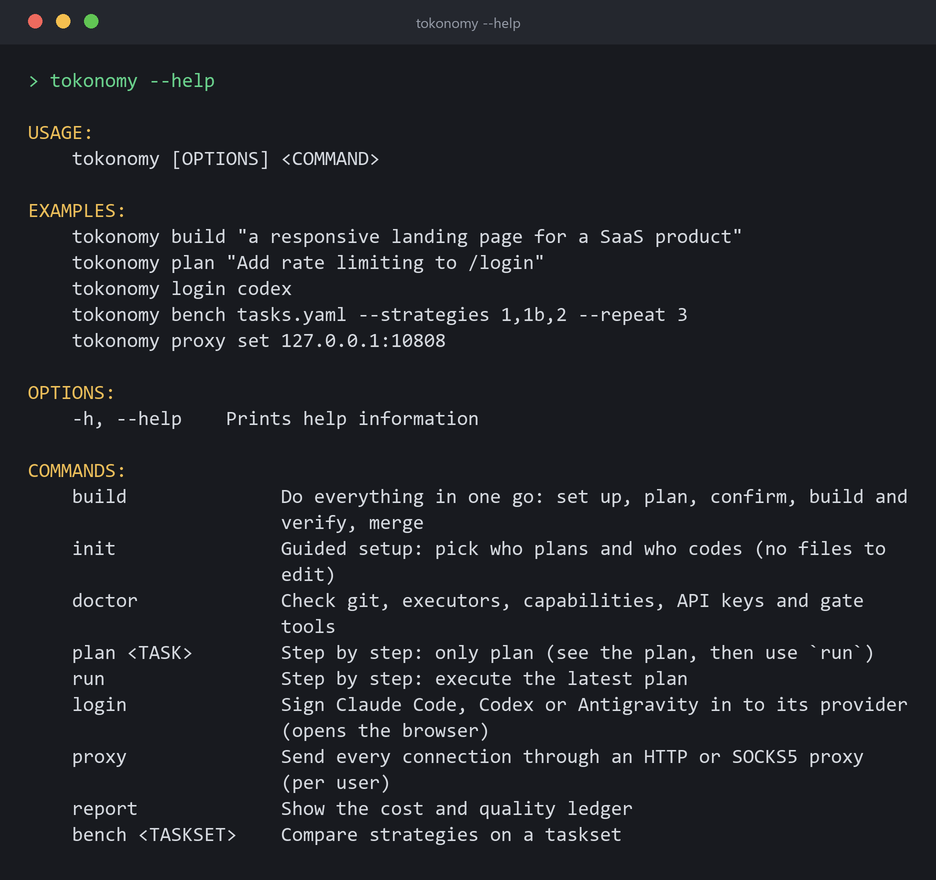
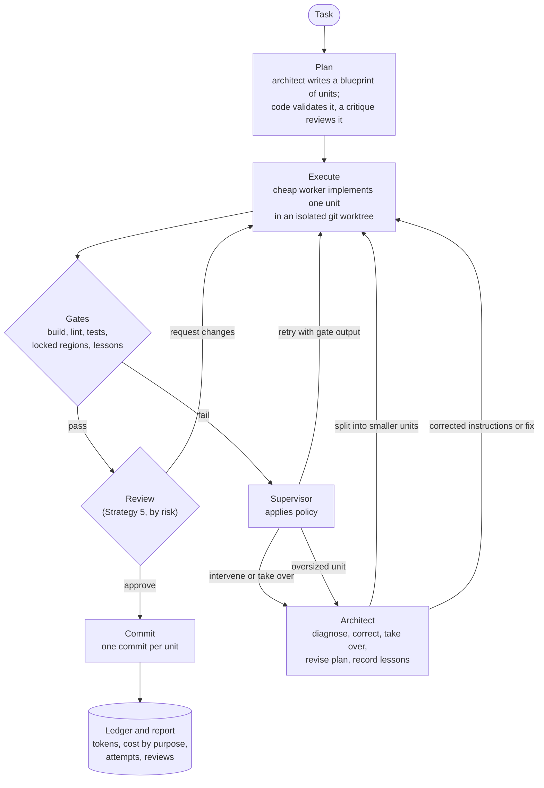
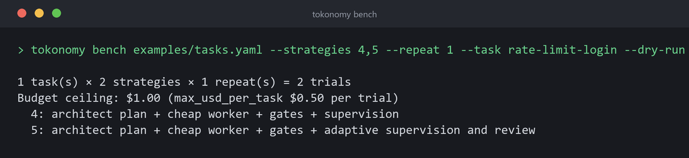
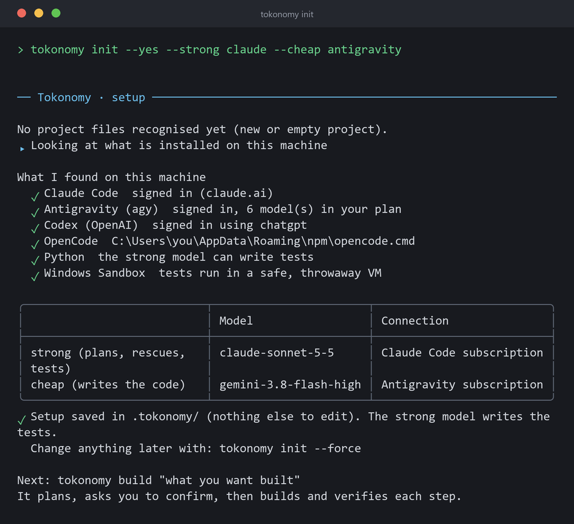

<div align="center">

# Tokonomy

**Adaptive orchestration for AI coding agents.**

[](https://github.com/DASaBeR/Tokonomy/actions/workflows/ci.yml)
[](LICENSE)


</div>

Tokonomy (token + economy) is an open-source CLI that sits on top of the coding agents you already use. A strong model plans the work once. A cheaper model writes the code, one unit at a time. Deterministic gates (build, lint, tests) decide whether each unit is accepted, and the strong model steps in only where it is needed: to retry with better instructions, split an oversized unit, review a risky diff, or take over. Every call is recorded in a cost ledger, so you can see what each accepted unit actually cost.

> ⭐ If you find Tokonomy interesting or useful, consider giving it a star! It helps the project gain visibility and motivates further development. Every star is appreciated.

<p align="center">
  
</p>

> **Status: pre-alpha.** The core hypothesis (a strong model used sparingly plus a cheap model verified by gates is cheaper per successful task) is still being tested, and the evidence so far is small. See [what the benchmarks do and do not show](#benchmarks).

## Contents

[The problem](#the-problem) · [What makes it different](#what-makes-tokonomy-different) · [How it works](#how-it-works) · [Strategies](#strategies) · [Benchmarks](#benchmarks) · [Install](#install) · [Quick start](#quick-start) · [Configuration](#configuration) · [Documentation](#documentation) · [Roadmap](#roadmap) · [Contributing](#contributing) · [License](#license)

## The problem

- **Not every coding task needs the strongest model.** Paying frontier prices for routine edits is wasteful, but cheap models fail on hard sections and drift from your architecture.
- **A cheap run that fails is not a saving.** The honest metric is *cost per successful task*, not cost per token.
- **Routing alone does not scale to projects.** Large builds need a plan, verification, review, and a way to react when a unit turns out to be too big or the plan was wrong.
- **Long agent runs break.** Machines reboot and providers hang. Work that is already verified should not be redone or paid for twice.

Tokonomy treats these as one workflow: plan, execute, verify, supervise, review, record.

## What makes Tokonomy different

| Capability | What it does | Why it matters |
|---|---|---|
| **Architect / worker routing** | A strong model plans, rescues and reviews; a cheap model writes the bulk of the code. Each can come from a different provider (Claude Code, Antigravity, Codex, OpenCode, or any OpenAI-compatible API). | You spend strong-model tokens only where they matter. |
| **Blueprint planning** | The architect reads the repository, then writes analysis, architecture, decisions and detailed units. Code validates the plan and a separate call critiques it before you see it. | The worker gets precise briefs instead of guessing design decisions. |
| **Deterministic gates** | Build, lint, type and test commands decide acceptance. They run in a disposable Windows Sandbox VM by default. | A model saying "done" counts for nothing. In the project-scale run the worker reported "Completed" every time, including once when the code did not build. |
| **Adaptive supervision** (Strategy 5) | On a blocker, repeated failure or scope deviation the architect diagnoses the cause and corrects instructions, applies a guarded fix, or takes over. It can split oversized units, revise the remaining plan and record lessons. | A failing unit gets targeted help instead of blind retries. |
| **Risk-based architectural review** | Units whose gates passed are reviewed for what gates miss: design, boundaries, patterns. A review can never override a failing gate. | In the project-scale run it sent back two units whose gates had all passed. |
| **Cost ledger and metering proxy** | Tokens and cost per tier and per purpose (planning, review, supervision, ...) are recorded, independent of what the agent reports. | You can see where the money went. |
| **Resume and recovery** | `tokonomy run --resume <run-id>` continues an interrupted run from its last verified commit. | Finished work is neither redone nor re-billed. |
| **Git-native** | Each run lives on its own branch with one commit per unit. | Review and merge are ordinary git. |
| **One proxy for everything** | `tokonomy proxy set` routes every model call, login, git and gate command through an HTTP or SOCKS5 proxy. | Works behind V2RayN or a corporate proxy without per-tool setup. |

## How it works



1. **Plan.** The architect investigates the repository and returns a blueprint: analysis, architecture, decisions and detailed units. Code checks structure and quality, and a separate critique call challenges the plan.
2. **Execute.** The worker implements each unit from a brief compiled from the current plan revision, in an isolated git worktree. It reports blockers instead of guessing.
3. **Gate.** Deterministic commands pass or fail the unit.
4. **Decide.** A rule-based supervisor accepts, retries with the gate output, or escalates. Strategy 5 additionally lets the architect intervene, split, revise the plan and review.
5. **Record.** Every call, attempt, intervention and review lands in the ledger, and `tokonomy report` summarises it.

Design principles: models produce content while policy makes decisions; gates outrank opinions; judge by the git diff, not the agent's report; if it is not in the ledger, it did not happen. Terms such as *gate*, *takeover* and *locked region* are in the [glossary](docs/glossary.md).

## Strategies

A strategy is a way of getting a task done. `tokonomy build` and `tokonomy plan` use Strategy 4 by default; Strategy 5 is opt-in. All six exist mainly so that `tokonomy bench` can compare them on your own tasks.

| Strategy | How the work is done | Supervision | Use it when |
|---|---|---|---|
| **1** | Strong model, single shot | none | You want a quality and cost baseline |
| **1b** | Strong model + gates + retries | gates and retries | You want to know how much gates alone help |
| **2** | Cheap model, single shot | none | You want to know how far a cheap model gets alone |
| **3** | Architect plan + cheap worker, no gates | none | You want to isolate the value of the plan |
| **4** (default) | Architect plan + cheap worker + gates | rule-based retry, then architect takeover on failure | Everyday use: tasks the plan can cover without surprises |
| **5** (opt-in) | Strategy 4 + adaptive supervision and review | architect diagnoses blockers, can correct, split, revise the plan; risk-based review | Large or uncertain plans where units may be oversized or the plan may be wrong |

**Strategy 5 is a trade-off, not an upgrade.** It spends extra strong-model calls on supervision and review. In a controlled live comparison on four small tasks, nothing went wrong that needed supervision, so it added about 16% cost per task and 37% execution time with no measurable quality gain ([details](docs/benchmarks/2026-11-13-strategy-4-vs-5/README.md)). Its value showed up only on a project-scale build, where plans were large and units oversized (see below). Details of the mechanisms: [adaptive supervision](docs/adaptive-supervision.md).

## Benchmarks

### Project-scale benchmark (Strategy 5)

Most coding benchmarks use isolated tasks. This experiment instead ran Strategy 5 on a **realistic, multi-module full-stack product built from a written specification**: an ASP.NET Core API, a Next.js frontend, PostgreSQL and Docker deployment. The purpose was to see how adaptive supervision behaves across a real project workflow. The project itself is private and is not described beyond its technical shape.

#### At a glance

| Metric | Result |
|---|---|
| Strategy | 5, one run, one plan |
| Models | Claude Sonnet 5.5 plans, supervises and reviews; Gemini 3.8 Flash (high) writes the code (both on subscriptions) |
| Project | Multi-module full-stack: ASP.NET Core, Next.js, PostgreSQL, Docker |
| Plan | 9 planned units; 18 after 2 automatic splits (16 accepted, 2 were split parents) |
| Gate results | All 16 accepted units passed both gate scripts (backend build and tests; frontend typecheck, lint, build and tests) |
| Result size | 89 backend and 141 frontend tests passing; about 27,300 lines added across 167 files (about 7,900 are one lockfile) |
| Worker attempts | 22 for 16 units (4 retries), **0 architect takeovers** |
| Strategy 5 activity | 3 interventions (2 splits, 1 blocker), 5 plan revisions, 3 lessons, 2 review change requests |
| Cost, passing run | $29.90 API-equivalent: worker $26.07, architect $3.83 (13%); about 5 h of active time |
| Cost, whole experiment | $52.30 API-equivalent over 13 runs, about 9 h 45 min wall time |
| Real money billed | None per token; both models ran on subscriptions |

#### What happened

The experiment started as a Strategy 4 versus Strategy 5 comparison. Strategy 4 failed on its second unit, which came out at 2,091 lines against a 400-line limit, and it cannot split units. The decision was to continue with Strategy 5 only, on the plan Strategy 4 had produced. Several earlier Strategy 5 runs stopped for reasons found along the way (a diff limit that was too low, a worker with no shell, an Antigravity sandbox flag that killed the session), and the 12th run in the experiment's timeline completed the plan.

In the passing run:

- **Planning:** one plan of nine units, reused unchanged from the earlier run.
- **Execution:** the worker took 11 to 15 minutes for typical feature units, and 38 minutes for the framework install.
- **Splitting:** two units (1,377 and 10,988 lines in one pass) were over the size limit. The architect diagnosed both as plan errors, split them into parts ordered by dependency, and every part passed on its first attempt.
- **Review:** 18 review events produced 14 approvals with warnings, 2 skipped as routine and 2 change requests. Both change requests concerned work that had passed every gate: a global monkey-patch of the API client and fetch, and broken backup commands plus documentation that contradicted the design. Both were fixed on the next attempt.
- **Supervision:** the architect diagnosed one environment blocker correctly and declined to work around a permission control.
- **Human involvement:** settings decisions, and two documented edits to run records to resume after a Tokonomy bug. No code in the generated project was written by hand.

#### Results and observations

Clearly separated by how well each is supported:

| | Observation |
|---|---|
| **Measured** | The plan completed with all gates passing. Cost, attempts, splits, review verdicts and interventions are exactly as in the table above and in [`metrics.json`](benchmarks/project-scale/metrics.json). |
| **Qualitative** | Splitting was necessary at this scale. Review found real defects that the gates did not. The reviewer saw truncated diffs on large units (at least five reviews said so). |
| **Not measured** | Whether the result meets the specification, whether it is better than Strategy 4's output, and whether lessons prevent repeated mistakes (none was shown to). |

Cost of the passing run by role:

| Role | Purpose | Calls | Cost |
|---|---|---:|---:|
| Worker | implementation | 22 | $26.07 |
| Architect | review | 16 | $3.33 |
| Architect | decomposition | 2 | $0.33 |
| Architect | supervision | 1 | $0.17 |

The experiment also surfaced Tokonomy bugs: one stopped the passing run at U6a and was fixed with tests, and others (for example, `--resume` refuses a run that stopped on a human decision) are still open and listed in the report.

#### Important limitations

This is an initial project-scale evaluation, **not** a controlled comparison and not proof that Strategy 5 is better than Strategy 4.

- One run, one plan, one project.
- The configured gates passed, but gates only show that code builds and its own tests pass.
- There was no independent quality review of the generated code. A hidden acceptance suite was written but never run, and the Docker images and compose stack were never built or run.
- There was no paired Strategy 4 comparison. Strategy 4's only attempt used default limits and no worker shell, so the two outcomes are confounded by settings.
- Settings changed during the experiment, and the passing run used the best-known configuration.
- The strong model both planned and reviewed.
- Costs are API-equivalent estimates.

#### Explore the full benchmark

| Resource | Description |
|---|---|
| [`benchmark-report.md`](benchmarks/project-scale/benchmark-report.md) | Full methodology, execution timeline, results, costs, interventions, limitations and recommendations. |
| [`metrics.json`](benchmarks/project-scale/metrics.json) | Machine-readable data: per-unit attempts, diffs, commands, reviews, events, lessons and cost breakdowns. |
| [`config/`](benchmarks/project-scale/config/) | Configuration used during the experiment. |
| [`gates/gate.py`](benchmarks/project-scale/gates/gate.py) | Gate script that checks backend and frontend quality gates. |

<details>
<summary><b>Reproducing the setup on your own project</b></summary>

> **Security warning.** The benchmark configuration used `host-unsafe` gates and `permissions.allow_all_commands`. The run executed model-written code on the host with the user's privileges. These are **not safe defaults**. Use them only on a trusted project on a disposable machine, and never copy them to a project or machine you do not trust. See [docs/config.md](docs/config.md) for the safer defaults.

1. Use a project with a written specification and an empty or small repository.
2. Copy [`config/`](benchmarks/project-scale/config/) to `<repo>/.tokonomy/`, replace the `<TOKONOMY_REPO>` and `<WORKTREE_ROOT>` placeholders, and set `models` and `architect_provider` for your own logins.
3. Put the specification in the task text or a file in the repository, then:

```sh
tokonomy plan "<task>" --strategy 5
tokonomy run --keep-worktree
# after an interruption:
tokonomy run --resume <run-id> --keep-worktree
```

4. Read `tokonomy report <run-id>` for cost by purpose, interventions, reviews and revisions.

**Not published.** The original specification, generated plan, worker briefs, transcripts, diffs, run records and acceptance tests describe or contain a private project, so they are not in this repository. `metrics.json` is generated from them with unit names reduced to generic labels.

</details>

### Earlier, smaller benchmarks

These are small and **not conclusive**; read [docs/benchmarking.md](docs/benchmarking.md) for data and limits.

- **Strategy 4 vs strategy 1b** (8 tasks, Claude Sonnet 5.5 as the strong model, DeepSeek V4.1 Flash as the worker): Strategy 4 passed 21/21 trials at about $0.047 per successful task, against 23/23 at $0.153 for the strong model alone with gates, roughly 3× cheaper. One taskset, one repository, one executor, and the cheap worker never failed, so it shows direction, not proof.
- **Strategy 4 vs 5** (4 tasks with a planted false assumption): both passed 4/4; Strategy 5 cost 16% more because nothing needed supervision. It stays opt-in.
- **Subscriptions pilot** (Opus plans, Gemini 3.8 Flash writes): passed 2/2, but the tasks were easy and Opus alone was cheaper in API-equivalent terms. What the split bought there was Claude quota.

Run your own comparison with `tokonomy bench`. Contributions of tasksets and results are welcome.

<p align="center">
  
</p>

## Install

```sh
# Linux / macOS
curl -fsSL https://github.com/DASaBeR/Tokonomy/releases/latest/download/install.sh | sh
```

```powershell
# Windows
irm https://github.com/DASaBeR/Tokonomy/releases/latest/download/install.ps1 | iex
```

Both installers verify SHA-256 checksums. Single-file binaries are published for Linux (x64/arm64, glibc and musl), macOS (x64/arm64) and Windows (x64/arm64). To build from source instead, see [Contributing](#contributing).

**Prerequisites:** `git`, and at least one way to reach a model: a Claude Code, Antigravity or Codex login, or an API key (OpenRouter, Anthropic, Gemini, OpenAI, DeepSeek, or any OpenAI-compatible endpoint). Python is needed if you want the strong model to write acceptance tests. Gate isolation uses **Windows Sandbox**, which is Windows-only; see [gate isolation](docs/gate-isolation.md) and the [threat model](docs/threat-model.md) before running on other platforms or on code you do not trust.

## Quick start

**One command.** In any folder:

```sh
tokonomy build "a responsive landing page for a SaaS product"
```

The first time, Tokonomy asks who plans and who codes, and writes the config. It then plans, shows the plan for confirmation, builds and verifies each step, and offers to merge the result. API keys are checked and kept only as a user environment variable, never in a project file.

<p align="center">
  
</p>

**Step by step**, for control over each stage:

```sh
cd your-repo
tokonomy init                                 # detect stack, choose models, write .tokonomy/
tokonomy doctor                               # check git, executors, keys, gate tools, prices
tokonomy plan "Add rate limiting to /login"   # architect writes the plan (add --strategy 5 for adaptive supervision)
tokonomy run                                  # worker executes each unit; gates decide; one commit per unit
git merge tokonomy/<run-id>                   # the result lives on its own branch
tokonomy report <run-id>                      # cost per tier and purpose, attempts, interventions, reviews
```

Run `tokonomy` with no arguments in a terminal for an interactive home screen. In a pipe or CI it prints help, and every command supports `--yes` and `--json`.

If a run is interrupted: `tokonomy run --resume <run-id>` ([recovery](docs/recovery.md)).

<details>
<summary><b>Working behind a proxy</b></summary>

```sh
tokonomy proxy set socks5://127.0.0.1:10808   # or an http:// address
tokonomy proxy test                           # checks the proxy, then each model or subscription through it
tokonomy proxy test --live                    # also one tiny real call per model
tokonomy proxy off                            # back to direct connections (the address is kept)
```

The setting is per user, saved in `%LOCALAPPDATA%\tokonomy\proxy.json`, and `TOKONOMY_PROXY` overrides it. Model calls, logins, git and gate commands use it; `localhost` never does. A password inside the proxy address is stored in that file and is visible to workers, so prefer a proxy without one. More in [docs/config.md](docs/config.md#proxy-per-user).

</details>

## Configuration

`tokonomy init` creates a `.tokonomy/` folder at the repository root:

| File | Commit it? | Purpose |
|---|---|---|
| `policy.yaml` | yes | Models, gates, gate isolation, escalation and supervision rules, budget |
| `executors.yaml` | yes | Adapters for coding-agent CLIs and the worker's shell permissions |
| `prices.yaml` | yes | Model prices used for cost accounting |
| `ledger.db`, `runs/` | no | Cost ledger and per-run artifacts |

Unknown keys are errors, reported with a line number, and `tokonomy doctor` validates everything. Gates **must** state where they run (`gate_execution`); there is no default and no fallback. Full reference: [docs/config.md](docs/config.md).

## Security

Git worktrees isolate changes, **not execution**. Gates run in a disposable Windows Sandbox VM with no network and no access to your files by default. The worker CLIs themselves run with your privileges under their own permission rules. Read the [threat model](docs/threat-model.md) before running Tokonomy on code you do not trust. There is no hosted service and no telemetry by default; your code goes only to the providers you configure.

## Documentation

| Topic | Documents |
|---|---|
| **Getting started** | [Quick start](#quick-start) · [Glossary](docs/glossary.md) |
| **Architecture** | [Project brief](PROJECT_BRIEF.md) · [Project overview](PROJECT_OVERVIEW.md) |
| **Strategies** | [Adaptive planning and supervision (Strategy 5)](docs/adaptive-supervision.md) |
| **Configuration** | [Configuration reference](docs/config.md) |
| **Execution and recovery** | [Crash recovery](docs/recovery.md) · [Gate isolation](docs/gate-isolation.md) · [Gate isolation research](docs/gate-isolation-research.md) · [Threat model](docs/threat-model.md) |
| **Benchmarking** | [Benchmarking guide and results](docs/benchmarking.md) · [Strategy 4 vs 5](docs/benchmarks/2026-11-13-strategy-4-vs-5/README.md) · [Project-scale benchmark](benchmarks/project-scale/README.md) |

## Roadmap

| State | Items |
|---|---|
| **Implemented** | Planning with blueprint and critique; supervised runs with gates, retries and architect takeover; Strategy 5 (adaptive supervision, splitting, lessons, risk-based review); crash recovery; cost ledger and metering proxy; benchmark harness; Windows Sandbox gate isolation; per-user proxy; executor adapters for Claude Code, Antigravity, Codex and OpenCode |
| **Planned** | Per-unit shell approval flow (the grant mechanism is built, the approval flow is not); resume after a human decision; letting the reviewer see whole diffs; splitting a split part again; a paired Strategy 4 vs 5 run with identical settings and repeats |

The planned items come from the [project-scale report's recommendations](benchmarks/project-scale/benchmark-report.md#13-recommendations-for-tokonomy) and the milestones in the [project brief](PROJECT_BRIEF.md). Nothing in the Planned row is available today.

## Contributing

Issues, benchmark results and pull requests are welcome. Report bugs and propose improvements through [GitHub Issues](https://github.com/DASaBeR/Tokonomy/issues). To run locally (requires the .NET 10 SDK):

```sh
git clone https://github.com/DASaBeR/Tokonomy.git
cd Tokonomy
dotnet build
dotnet test
dotnet run --project src/Tokonomy.Cli -- --help
```

Please run `dotnet test` before opening a pull request. There is no separate contribution guide yet.

## License

[MIT](LICENSE) © Mohsen Saberi

<sub>Keywords: AI coding agents, LLM orchestration, reduce LLM costs, token cost optimization, multi-agent coding, cost per successful task, Claude Code, Codex, Gemini CLI, OpenCode, quality gates, .NET CLI, open source.</sub>
